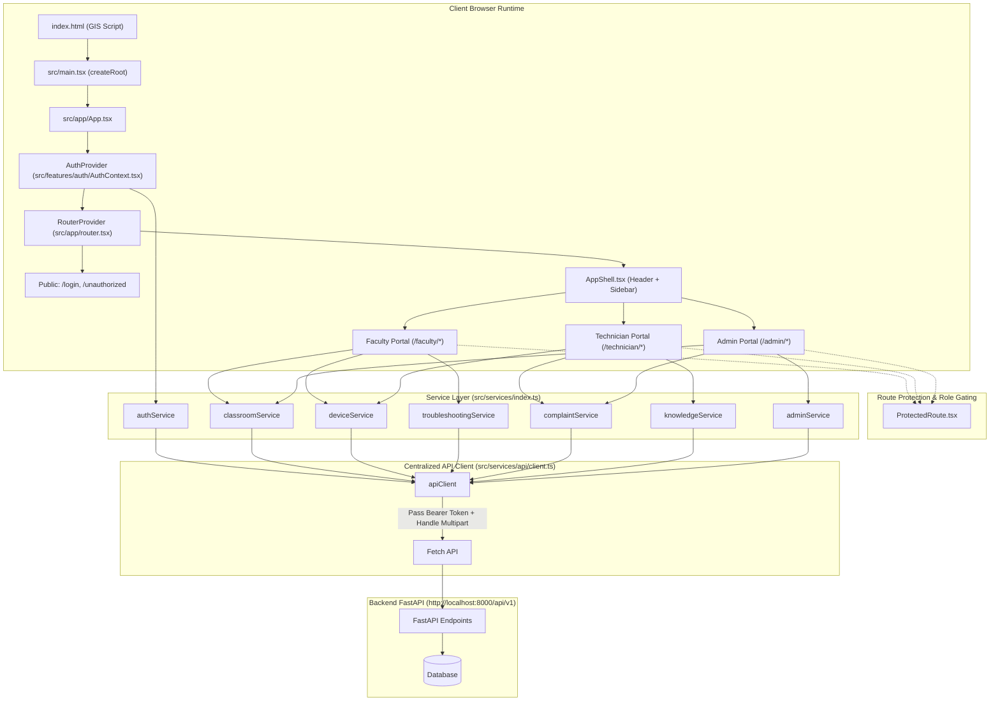
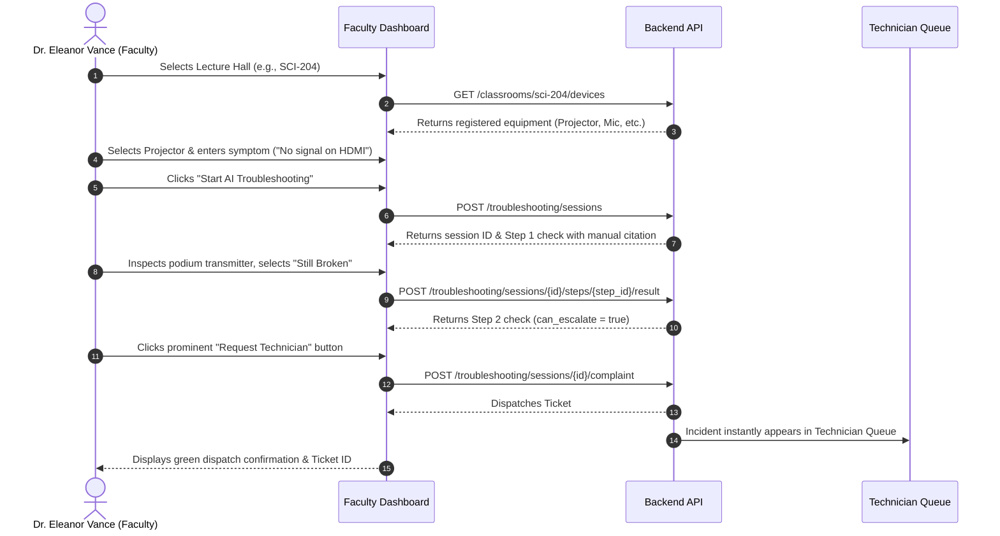
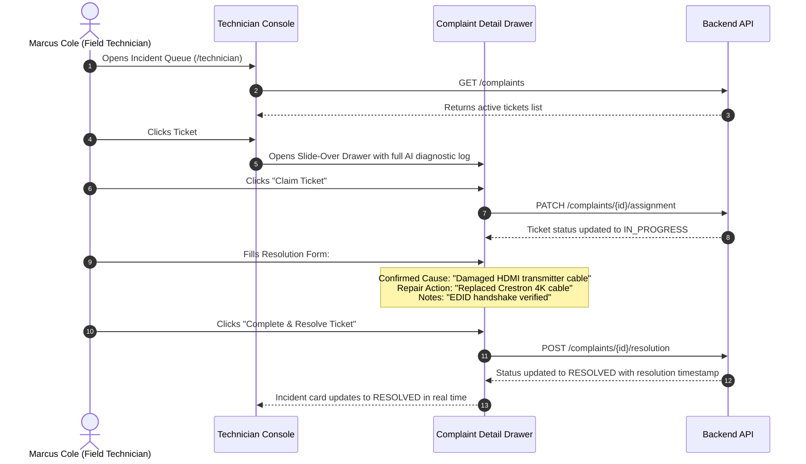

# ClassFix AI — Frontend Folder Architecture & Implementation Guide

> **AI-Powered Smart Classroom Audio-Visual Troubleshooting & Incident Management Platform**  
> Comprehensive technical documentation of the entire frontend architecture, directory hierarchy, component ecosystem, state management, API integration layer, and user workflows.

---

## 1. Executive Technology Stack

| Layer | Technology | Version | Purpose |
| :--- | :--- | :--- | :--- |
| **Framework** | **React** | `19.0.0` | UI component tree, virtual DOM, and reactive hooks |
| **Language** | **TypeScript** | `5.7.3` | Strict static typing across domain models, DTOs, and API contracts |
| **Bundler & Server** | **Vite** | `6.1.0` | High-speed ESM development server and Rollup production bundling |
| **Routing** | **React Router DOM** | `7.2.0` | Declarative client-side routing with data router architecture (`createBrowserRouter`) |
| **Styling** | **Tailwind CSS** | `3.4.17` | Utility-first CSS configured with custom university light-theme tokens |
| **CSS Processing** | **PostCSS & Autoprefixer** | `8.5.2` / `10.4.20` | Vendor prefixing and modern CSS parsing |
| **Iconography** | **Lucide React** | `0.475.0` | Lightweight, scalable vector icons |
| **Package Manager**| **npm** | `10.x` | Dependency resolution and lockfile maintenance |
| **Backend API Target** | **FastAPI** | REST | Target API base URL: `http://localhost:8000/api/v1` |

---

## 2. Complete Folder & File Tree Architecture

```
D:\ClassFix_AI\
├── .env                              # Active local environment variables
├── .env.example                      # Template environment configuration
├── .gitignore                        # Git exclusion rules (node_modules, dist, .env)
├── .oxlintrc.json                    # Code linter rules
├── FRONTEND_ARCHITECTURE.md          # Comprehensive frontend architecture documentation
├── index.html                        # HTML5 document template & Google GIS script entry
├── package.json                      # Project manifest, dependencies, and npm scripts
├── package-lock.json                 # Deterministic dependency lockfile
├── postcss.config.js                 # PostCSS pipeline configuration
├── README.md                         # Project overview and quickstart guide
├── tailwind.config.js                # Design system tokens, color palette, and layout extensions
├── tsconfig.json                     # Root TypeScript configuration
├── tsconfig.app.json                 # Application-specific strict TypeScript options
├── tsconfig.node.json                # Node/Vite build tool TypeScript options
├── vite.config.ts                    # Vite plugin configuration and path alias resolution (@/)
│
├── public/                           # Static public directory
│   └── vite.svg                      # Static vector favicon
│
└── src/
    ├── main.tsx                      # Application DOM entry point (createRoot)
    ├── vite-env.d.ts                 # TypeScript declarations for Vite client environment variables
    │
    ├── app/                          # Core application shell & router bootstrap
    │   ├── App.tsx                   # Top-level component wrapping AuthProvider and RouterProvider
    │   └── router.tsx                # Central routing table, ProtectedRoute wrappers, & 404 page
    │
    ├── assets/                       # Component-level static graphics & SVG assets
    │   ├── hero.png                  # Platform preview graphic
    │   ├── react.svg                 # React brand icon
    │   └── vite.svg                  # Vite brand icon
    │
    ├── components/                   # Shared UI building blocks
    │   ├── layout/                   # Structural layout components
    │   │   ├── AppShell.tsx          # Responsive layout shell (Sidebar + Header + Outlet)
    │   │   ├── Header.tsx            # Sticky top bar with breadcrumb title, user menu & sign-out
    │   │   ├── PageHeader.tsx        # Standard page title banner with breadcrumb navigation & action buttons
    │   │   └── Sidebar.tsx           # Collapsible vertical navigation bar with role-filtered links
    │   │
    │   └── ui/                       # Reusable design system primitives
    │       ├── Badge.tsx             # Status indicator pill with dot & color variants
    │       ├── Button.tsx            # Standard interactive button with variants & loading state
    │       ├── Card.tsx              # Elevated white content surface with header/content dividers
    │       ├── EmptyState.tsx        # Dashed container displaying when database returns empty lists
    │       ├── ErrorState.tsx        # Error banner with retry action for network failures
    │       └── LoadingState.tsx      # Centered loading spinner with descriptive operation message
    │
    ├── features/                     # Feature modules grouped by domain and role
    │   ├── auth/                     # Authentication & Authorization module
    │   │   ├── AccessDeniedPage.tsx  # 403 Forbidden screen when user lacks required role
    │   │   ├── AuthContext.tsx       # React Context provider managing user session & login/logout
    │   │   ├── LoginPage.tsx         # Refined two-column Google Workspace sign-in screen
    │   │   └── ProtectedRoute.tsx    # Higher-Order Route Guard enforcing auth and role permissions
    │   │
    │   ├── faculty/                  # Faculty lecture hall & troubleshooting portal
    │   │   ├── ClassroomDeviceSelector.tsx      # Interactive room & registered device selector
    │   │   ├── FacultyClassroomEquipmentPage.tsx# Equipment list for /faculty/classrooms/:classroomId
    │   │   ├── FacultyClassroomsPage.tsx        # Campus classroom fleet directory overview
    │   │   ├── FacultyComplaintsPage.tsx        # Faculty personal reported incidents list
    │   │   ├── FacultyDashboard.tsx             # Primary faculty console with symptom prompt & session restore
    │   │   ├── FacultyDeviceDetailsPage.tsx     # Hardware specs at /classrooms/:cid/devices/:did
    │   │   └── InteractiveTroubleshooter.tsx    # Sequential AI diagnostic check card with manual citations
    │   │
    │   ├── technician/               # Field Technician dispatch & repair portal
    │   │   ├── ComplaintDetailDrawer.tsx        # Slide-over incident drawer with triage & resolution form
    │   │   ├── TechnicianDashboard.tsx          # Primary ticket queue with status tabs & metrics
    │   │   ├── TechnicianEquipmentPage.tsx      # Hardware directory with registration modal
    │   │   └── TechnicianManualsPage.tsx        # Technical service manuals library with PDF upload modal
    │   │
    │   └── admin/                    # Campus Administration & Telemetry portal
    │       ├── AdminClassroomsPage.tsx          # Classroom management table with Add Room modal
    │       ├── AdminDashboard.tsx               # Executive operational overview & SLA metrics
    │       ├── AdminReportsPage.tsx             # Incident analytics, SLA velocity, & category distribution
    │       └── AdminUsersPage.tsx               # Campus user directory with role assignment modal
    │
    ├── services/                     # Business logic & API communication layer
    │   ├── api/
    │   │   ├── client.ts             # Centralized ApiClient class handling fetch, auth headers, & envelopes
    │   │   └── config.ts             # API base URL and client environment configuration
    │   │
    │   ├── admin.service.ts          # IAdminService interface contract
    │   ├── auth.service.ts           # IAuthService interface contract
    │   ├── classroom.service.ts      # IClassroomService interface contract
    │   ├── complaint.service.ts      # IComplaintService interface contract
    │   ├── device.service.ts         # IDeviceService interface contract
    │   ├── knowledge.service.ts      # IKnowledgeService interface contract
    │   ├── troubleshooting.service.ts# ITroubleshootingService interface contract
    │   └── index.ts                  # Production service instances communicating with real backend API
    │
    ├── styles/                       # Global styling
    │   └── index.css                 # Tailwind directives, CSS root variables, & custom scrollbars
    │
    ├── types/                        # TypeScript domain contracts
    │   └── index.ts                  # Central domain models (User, Classroom, Device, Complaint, Session, DTOs)
    │
    └── utils/                        # Shared utility helpers
        └── cn.ts                     # Class name merger combining clsx and tailwind-merge
```

---

## 3. High-Level Architectural Flow



---

## 4. Complete Page and Route Inventory

All application routes are defined in [`src/app/router.tsx`](file:///d:/ClassFix_AI/src/app/router.tsx).

### 4.1. Public & Core Routing

| Route | Component | Guard / Access | Purpose |
| :--- | :--- | :--- | :--- |
| `/` | `RootRedirect` | Authenticated | Redirects user to their database role dashboard (`/${currentUser.role}`) |
| `/login` | `LoginPage` | Public | Google Workspace Single Sign-On and manual token authentication |
| `/unauthorized` | `AccessDeniedPage` | Public | 403 Forbidden screen shown when user lacks required role permissions |
| `/access-denied`| `AccessDeniedPage` | Public | Alias to `/unauthorized` |
| `*` | `NotFoundPage` | Public | 404 Catch-All page with button returning to campus overview |

---

### 4.2. Faculty Module (`/faculty`)
*Protected by `ProtectedRoute allowedRoles={['faculty']}`*

| Route | Component | API Calls | Description |
| :--- | :--- | :--- | :--- |
| `/faculty` | `FacultyDashboard` | `GET /classrooms`<br>`GET /classrooms/{id}/devices`<br>`GET /complaints` | Primary dashboard for active lectures; room/device selection & quick symptom chip selection. |
| `/faculty/troubleshooting` | `FacultyDashboard` | `POST /troubleshooting/sessions`<br>`POST .../steps/next`<br>`POST .../steps/{id}/result`<br>`POST .../complete`<br>`POST .../complaint` | Full interactive RAG troubleshooting session with step results & one-click technician dispatch. |
| `/faculty/classrooms` | `FacultyClassroomsPage` | `GET /classrooms` | Campus lecture hall directory displaying seating capacity, active tickets, and status. |
| `/faculty/classrooms/:classroomId` | `FacultyClassroomEquipmentPage` | `GET /classrooms/{id}`<br>`GET /classrooms/{id}/devices` | Equipment inventory registered in the specified classroom. |
| `/faculty/classrooms/:classroomId/devices/:deviceId` | `FacultyDeviceDetailsPage` | `GET /devices/{id}`<br>`GET /classrooms/{id}` | Detailed technical specifications, IP address, serial number, and "Start AI Troubleshooting" action. |
| `/faculty/complaints` | `FacultyComplaintsPage` | `GET /complaints` | Historical and active incident reports submitted by the logged-in faculty member. |

---

### 4.3. Field Technician Module (`/technician`)
*Protected by `ProtectedRoute allowedRoles={['technician']}`*

| Route | Component | API Calls | Description |
| :--- | :--- | :--- | :--- |
| `/technician` | `TechnicianDashboard` | `GET /complaints`<br>`GET /devices` | Operational console with 3 top metrics, primary searchable incident queue, and hardware alert list. |
| `/technician/complaints` | `TechnicianDashboard` | `GET /complaints` | Filterable incident queue with status tabs (`ALL`, `PENDING`, `IN_PROGRESS`, `RESOLVED`, `ESCALATED`). |
| `/technician/equipment` | `TechnicianEquipmentPage` | `GET /devices`<br>`GET /classrooms`<br>`POST /devices`<br>`PATCH /devices/{id}/status` | Campus hardware inventory with new device registration modal and operational status toggle. |
| `/technician/manuals` | `TechnicianManualsPage` | `GET /knowledge/documents`<br>`POST /knowledge/documents`<br>`POST /knowledge/documents/{id}/reindex` | Technical service manuals library with PDF file upload modal and re-indexing trigger. |

---

### 4.4. Campus Administrator Module (`/admin`)
*Protected by `ProtectedRoute allowedRoles={['admin']}`*

| Route | Component | API Calls | Description |
| :--- | :--- | :--- | :--- |
| `/admin` | `AdminDashboard` | `GET /admin/overview`<br>`GET /classrooms`<br>`GET /complaints` | Executive overview of fleet health (uptime %, active incidents, SLA resolution velocity). |
| `/admin/users` | `AdminUsersPage` | `GET /admin/users`<br>`POST /admin/users`<br>`PATCH /admin/users/{id}/role` | University staff directory with role assignment dropdown (`faculty`, `technician`, `admin`) and Add User modal. |
| `/admin/classrooms` | `AdminClassroomsPage` | `GET /classrooms`<br>`POST /classrooms`<br>`PATCH /classrooms/{id}` | Classroom fleet manager with Add Room modal and operational status management. |
| `/admin/devices` | `TechnicianEquipmentPage` | `GET /devices`<br>`POST /devices` | Administrative view of the full campus device inventory. |
| `/admin/complaints` | `TechnicianDashboard` | `GET /complaints` | Administrative global view of all campus incident tickets. |
| `/admin/reports` | `AdminReportsPage` | `GET /admin/reports/summary` | SLA analytics, priority breakdowns, category distributions, and resolution velocity metrics. |

---

## 5. Authentication & Authorization Architecture

### 5.1. Session Flow & Token Handling
1. **Google Single Sign-On**:
   - `index.html` loads Google Identity Services (`gsi/client`).
   - When the user signs in with Google, an ID token (JWT) is returned.
2. **Backend Token Verification (`POST /auth/google`)**:
   - The frontend sends the Google ID token to the backend:
     ```json
     {
       "token": "<google_id_token>",
       "id_token": "<google_id_token>",
       "credential": "<google_id_token>"
     }
     ```
   - The backend verifies the cryptographic signature with Google and confirms the user exists in the campus database.
3. **Session Token Storage**:
   - The returned application JWT/session token is stored in `sessionStorage.setItem('classfix_auth_token', token)`.
   - Credentials are also transmitted via HTTP-only cookies where configured (`credentials: 'include'`).
4. **Subsequent API Requests**:
   - Central `apiClient` checks `sessionStorage.getItem('classfix_auth_token')`.
   - Attaches `Authorization: Bearer <token>` to every outgoing request.
5. **Session Expiration / 401 Unauthorized**:
   - If the backend returns `401 Unauthorized`, `apiClient` automatically removes the token from `sessionStorage` and triggers a redirect to `/login`.
6. **Sign-Out (`POST /auth/logout`)**:
   - The user selects "Sign Out" from the header account menu.
   - Dispatches `POST /auth/logout`, purges `sessionStorage`, clears user context, and navigates to `/login`.

### 5.2. Role-Based Route Guard (`ProtectedRoute.tsx`)
```typescript
interface ProtectedRouteProps {
  children: React.ReactNode
  allowedRoles?: UserRole[] // 'faculty' | 'technician' | 'admin'
}
```
- **If unauthenticated**: Redirects to `/login` preserving the attempted destination in `location.state.from`.
- **If authenticated but lacks permission**: Redirects to `/unauthorized` (`AccessDeniedPage`).
- **If authenticated with valid role**: Renders the child component tree.

---

## 6. Centralized API Client Architecture

Implemented in [`src/services/api/client.ts`](file:///d:/ClassFix_AI/src/services/api/client.ts).

### 6.1. Capabilities
1. **Base URL Normalization**: Resolves against `VITE_API_BASE_URL` (defaults to `http://localhost:8000/api/v1`).
2. **Envelope Unwrapping**:
   - If the backend wraps responses in `{ "data": ... }`, `apiClient` extracts and returns the inner data.
   - If the backend returns raw JSON or arrays, it passes them through directly.
3. **Structured Error Extraction**:
   - Parses standard error envelopes: `{ "error": { "code": "...", "message": "...", "details": {} } }`.
   - Parses FastAPI validation arrays: `{ "detail": [ { "msg": "..." } ] }`.
   - Throws typed `ApiError(statusCode, message, code, details)`.
4. **Multipart Form-Data Handling**:
   - Dedicated `postFormData<T>(endpoint, formData)` for PDF technical manual uploads without manually setting `Content-Type` (allowing browser boundary calculation).

---

## 7. Design System & Chrome Viewport Calibrations

Configured in [`tailwind.config.js`](file:///d:/ClassFix_AI/tailwind.config.js) and [`src/styles/index.css`](file:///d:/ClassFix_AI/src/styles/index.css).

### 7.1. Color Tokens

```css
:root {
  --bg-app:          #F8FAF8; /* Main glare-free background */
  --border-app:      #E3E9E4; /* Crisp structural border */
  --text-main:       #202824; /* Primary readable text (WCAG AAA) */
  --text-muted:      #66736C; /* Secondary metadata text */
  --primary-green:   #1B4D3E; /* Authoritative institutional green */
  --secondary-green: #E7F1EB; /* Active pill highlights & chips */
  --soft-green:      #F0F6F1; /* Callout banners & backgrounds */
  --warning:         #B7791F; /* Medium priority & alerts */
  --error:           #C2413B; /* Critical issues & destructive actions */
  --success:         #27815B; /* Healthy equipment & resolved tickets */
}
```

### 7.2. Viewport Optimization
The application layout is fully responsive and calibrated for Google Chrome at:
- **1366 × 768**: Standard university podium laptops.
- **1440 × 900**: MacBook and ultrabook displays.
- **1920 × 1080**: IT AV dispatch control room monitors at 100% zoom.
- Zero horizontal scrollbars or overflow across all standard resolutions.

---

## 8. Complete User Workflows by Role

### 8.1. Faculty Lecture Troubleshooting Workflow


---

### 8.2. Field Technician Incident Resolution Workflow


---

### 8.3. Campus Administrator Operations & Provisioning Workflow
1. **Classroom Management (`/admin/classrooms`)**:
   - Admin views the entire campus room fleet.
   - Clicks **"Add Classroom"**, enters room number, building, floor, seating capacity, and features.
   - Submits form → `POST /classrooms`. The directory reloads instantly.
2. **User Access & Role Management (`/admin/users`)**:
   - Admin inspects the provisioned user directory.
   - Selects a user's role dropdown and changes permissions (e.g. from `faculty` to `technician`).
   - Dispatches `PATCH /admin/users/{id}/role`.
3. **Operations SLA Telemetry (`/admin/reports`)**:
   - Admin reviews overall fleet health, mean time to resolution (MTTR), and incident velocity.
   - Dispatches `GET /admin/reports/summary`.

---

## 9. How to Build and Run the Frontend

### 9.1. Environment Configuration
Ensure `.env` in the root directory contains:
```ini
# Backend API Base URL
VITE_API_BASE_URL=http://localhost:8000/api/v1

# Application Environment
VITE_APP_ENV=development

# Google Workspace OAuth Client ID for institutional SSO
VITE_GOOGLE_CLIENT_ID=
```

### 9.2. Installation & Development Server
```bash
# Install dependencies
npm install

# Start Vite development server
npm run dev
```
The application will be live at `http://localhost:5173/`.

### 9.3. Production Build & TypeScript Verification
```bash
npm run build
```
Executes `tsc -b && vite build`. Produces minified, optimized production assets in `dist/` with zero TypeScript errors.

---

*This document serves as the single source of truth for the ClassFix AI frontend architecture.*

